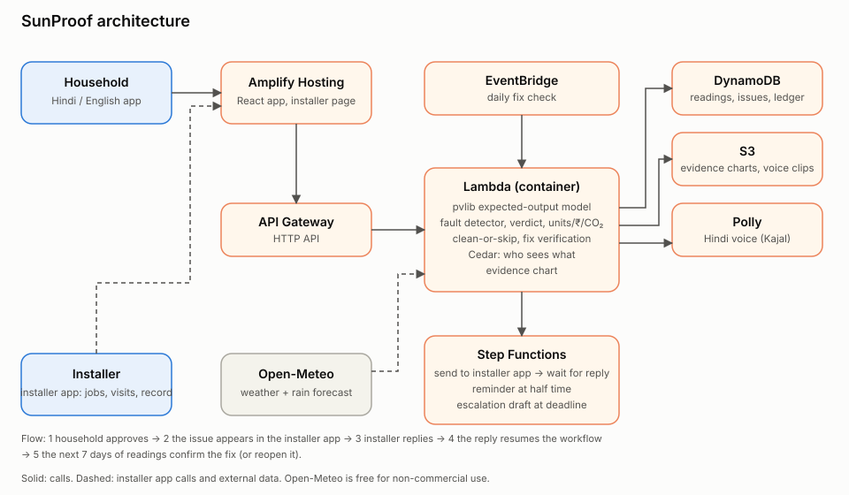

# SunProof

An independent audit and fix-tracking service that recovers lost clean energy from household rooftop solar.

Built for **WeMakeDevs Environmental Hacks** (Waste and Energy track), Oct 8–11, 2026.

> **Demo data:** the households in this repo are **demo households built from public plant data, not real homes**. Real household and US rooftop checks are listed under "Next steps".

## The problem

After a rooftop system is installed, three parties can each cost the household money, and the household has no independent way to tell which one:

1. **The vendor** may have installed a weak system.
2. **The DISCOM** may mis-bill the exported units.
3. **Dust and shade** may quietly reduce output.

Every unit a faulty, dusty or shaded system fails to produce is replaced by grid power, which in India comes mostly from coal. Finding the problem is only half of it: the household then has to reach the installer, explain the issue without technical language, chase a reply, and judge whether the "fix" worked. Most give up, and the loss continues month after month.

SunProof finds lost clean generation, gets the problem to the responsible party with evidence, follows up, confirms the fix, and counts the clean energy recovered.

## What it does

| Feature | How it works |
|---|---|
| **Expected vs actual** | An open-source solar model ([pvlib](https://pvlib.readthedocs.io/)) plus weather gives an expected daily range for the roof. Every shortfall is shown as **units lost, ₹ lost and kg CO₂ added**. |
| **Plain-words verdict, in Hindi** | The verdict is written in simple Hindi and English, and read aloud with Amazon Polly. Wording is always "worth checking", never an accusation. |
| **Clean or skip** | Uses the rain forecast and estimated dust loss to say whether cleaning pays, or "Skip, rain on Sunday". |
| **Send to my installer** | The household approves, then SunProof emails the installer an evidence chart and a no-signup response link. |
| **Follow up** | A Step Functions workflow tracks a 7-day response window, sends a reminder at half time, and drafts an escalation for the household to file if there is no reply. |
| **Verify the fix** | After the installer replies, SunProof checks the next 7 days of generation. Back in range closes the issue as **Fixed ✅** and adds to the **clean energy recovered** counter. Still low reopens it with the installer. |
| **Who sees what** | [Cedar](https://www.cedarpolicy.com/) policies: the installer sees generation data and evidence, never the bill or contact details, and nothing is sent without the household's approval. |
| **Published accuracy** | A blind fault-injection test on real Indian plant data (see below). |

## Accuracy

We hide known faults in real Indian solar plant data, run the same detector the product uses (without telling it where the faults are), and score it. Thresholds were tuned on 11 inverters of Plant 1 and tested on the other 11, over 20 random fault layouts.

| Fault | Caught |
|---|---|
| System stopped | **60 of 60** (within 2 days) |
| Sudden 20% drop | **40 of 40** (within 2 days) |
| Gradual dust build-up | **30 of 38** (within 7 days of the loss crossing 5%) |
| False alarms | **0.56%** of healthy inverter-days (31 of 5,561) |

On the original, untouched data the same method also spots two real Plant 1 inverters producing 7–8% less than their neighbours under the same sun.

**What this does and doesn't show:**

- The data comes from two large plants, not homes, and **the faults are injected by us**. This shows detection ability, not guaranteed field accuracy.
- Catching a stopped system is easy because output is zero. The 20% drop and dust results are the meaningful ones.
- Plant 2's output swings about 27% around its own sunlight sensor on every inverter, so it is **not used for headline accuracy**. We report it separately.
- Not yet tested on real Indian rooftops or US residential systems (NREL PVDAQ). Next step.

Reproduce it: `python -m accuracy.run_kaggle` writes `accuracy/report.json` deterministically (fixed seed).

## Architecture



| Job | AWS service |
|---|---|
| Solar model, fault detection, verdicts, evidence charts, API | **Lambda** (container image) behind **API Gateway** |
| Readings, issues, recovery ledger | **DynamoDB** |
| Evidence charts, voice clips | **S3** |
| Response window, reminder, escalation, fix check | **Step Functions** (wait for the installer's reply) |
| Daily fix check | **EventBridge** |
| Hindi voice summary | **Polly** (Kajal, hi-IN) |
| Installer email | **SES** |
| Who sees what | **Cedar** policies, evaluated in the API Lambda |
| Household app and installer response page | **Amplify Hosting** |

## Data sources

- **Indian plants:** [Solar Power Generation Data (Kaggle)](https://www.kaggle.com/datasets/anikannal/solar-power-generation-data): two plants, 34 days, 22 inverters each. Data files © original authors. Not committed to this repo.
- **CO₂ factor:** 0.705 kg CO₂ per kWh, combined margin, [CEA CO₂ Baseline Database v22.0](https://cea.nic.in/wp-content/uploads/baseline/2026/09/User_Guide__Version_22.0.pdf), FY 2025-26.
- **Tariff:** ₹8 per unit default (Delhi domestic, upper slab with surcharge), editable per household.
- **Weather and rain:** [Open-Meteo](https://open-meteo.com/), free for non-commercial use. That suits a hackathon, not a paid rollout.
- **Soiling:** average loss of 7.6% a month from a Delhi field test; the source needs citing before this is relied on.

## Limits, stated honestly

- **Verdicts are ranges, not accusations.** A weather model gives a range, not a precise number, so every verdict and installer message says "worth checking".
- **Trips are not caught the same day.** A stopped system shows up in the daily check as a large shortfall, not as an instant alert.
- **The escalation is a draft.** SunProof does not file anything with any government system.
- **Fix verification in the demo uses replayed data**, labelled REPLAY.
- **Demo installer:** the installer in the demo is a test email address, labelled "test installer".
- **Demo clock:** `DEMO_TIME_SCALE` shortens the 7-day window for demos (1 = real time).
- **Demo endpoints:** `/demo/reset` and `/demo/replay-fix` are unauthenticated and exist for the demo. Turn them off with `DemoMode=false` when deploying.
- **No household login.** The demo has no sign-in: anyone who knows a home's ID can read its verdict, and the household screen is not access-controlled. This is safe here only because every home is a public-data demo. The Cedar rules do enforce the installer side (the installer sees generation data and evidence only, never the bill or contact details) and the household's approval before anything is sent. A real rollout needs household sign-in (for example Amazon Cognito), per-home ownership, and a way to add a home and its readings. That is the first next step.
- **Bill check and warranty reminder** are not built.
- **Email only.** SMS in India needs DLT registration.
- **Installer contact details** are entered by the household once; in a rollout they could come from the PM Surya Ghar portal.

## Run it

Requirements: Python 3.12, Node 20.19+ (or 22.12+), Docker, AWS CLI, AWS SAM CLI.

```bash
# engine and accuracy tests
python3.12 -m venv .venv && .venv/bin/pip install -r requirements-dev.txt
.venv/bin/pytest engine accuracy

# data (download the Kaggle zip and unzip it somewhere outside the repo)
export SUNPROOF_DATA=~/datasets/kaggle-solar
.venv/bin/python -m accuracy.make_demo_household   # demo households
.venv/bin/python -m accuracy.run_kaggle            # accuracy report

# backend: put these in .env.local (gitignored), then deploy
#   SENDER_EMAIL=<SES-verified address>
#   INSTALLER_EMAIL=<test installer address>
#   DEMO_TIME_SCALE=1        # 1440 = the 7-day window runs in 7 minutes
./scripts/deploy_api.sh

# website
cd web && npm install && npm run dev               # local
AMPLIFY_APP_ID=<id> ../scripts/deploy_web.sh       # deploy to Amplify
```

Seed or reset the demo households: `POST <ApiUrl>/demo/reset`.

## Repository layout

```
engine/      expected output (pvlib), detector, verdict, clean-or-skip, evidence chart, fix verification
accuracy/    fault injector, Kaggle accuracy run, demo household builder, report.json
backend/     SAM template, API Lambda, Step Functions definition, Cedar policies
web/         React + Vite + Tailwind app (household, installer, accuracy pages)
docs/        API contract, module specs, architecture diagram, demo script, handoff notes
```

## Licence

The code is released under the [MIT licence](LICENSE). The datasets are **not** included and are not covered by it: the Kaggle plant data belongs to its original authors and must be downloaded from Kaggle under its terms; Open-Meteo data and the CEA emission factor are used under their own terms, as described under "Data sources".

## Next steps

Household sign-in with add-your-home and readings entry, real household pilot, US rooftop accuracy check (NREL PVDAQ), bill check (Textract), warranty reminder, an installer report card, a fleet dashboard for installers (the paid version), and routing to DISCOM billing desks.
